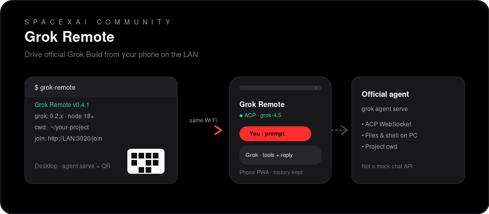

# Grok Remote

**Unofficial community companion** for [SpaceXAI Grok Build](https://x.ai/cli): drive the real desktop agent from your phone (or any browser) over the local network.

<p align="center">
  
</p>

```bash
# one-shot (when published to npm)
npx grok-remote

# or from a clone
cd ~/your-project
grok-remote
# Phone (same Wi‑Fi): open the join URL / scan the QR
```

Not affiliated with or endorsed by xAI / SpaceXAI. Requires the official `grok` CLI installed and logged in on your computer.

**Tested with:** Grok Build CLI `0.2.x` · Node.js 18+

---

## Features

- **QR / join URL pairing** — phone camera opens `http://LAN:3020/join`
- **Real Grok Build agent** via ACP (`grok agent serve`), not a mock chat API
- **Project cwd** = the directory where you launched `grok-remote`
- **Shell on the desktop** — terminal bridge so agent shell tools work from the phone
- **Files** — browse/read/write via agent FS extensions
- **Chat history on the phone** — transcript restores after reconnect / app reopen
- **Session attach** — optionally join a desktop/TUI session (`-c` / `--session`) so agent memory is shared
- **Add to Home Screen** — true PWA install (Install button + iOS/Android guidance; service worker app shell)

---

## Prerequisites

| Requirement | Notes |
|-------------|--------|
| **Node.js 18+** | For the launcher + PWA server |
| **`grok` CLI** | [Install](https://x.ai/cli) and run `grok login` once |
| **Same Wi‑Fi** | Phone and PC on the same LAN (not guest isolation if possible) |

Check:

```bash
node -v
grok --version
grok models   # should show you are logged in
```

---

## Install

### Quick (`npx`)

```bash
cd ~/your-project
npx grok-remote
```

Requires network access the first time so npm can fetch the package. You still need the `grok` CLI on the machine.

### From GitHub

```bash
git clone https://github.com/ghostrunner42/grok-remote-pwa.git
cd grok-remote-pwa
npm install
npm link          # puts `grok-remote` on your PATH (optional)
```

Without linking:

```bash
node /path/to/grok-remote-pwa/launcher.js
# or
npx --yes --prefix /path/to/grok-remote-pwa grok-remote
```

---

## Usage

```bash
cd ~/Documents/MyProject   # agent workspace = this directory
grok-remote
```

Then on your phone:

1. Point the **system camera** at the QR (or open **`http://<printed-lan-ip>:3020/join`**). That is the intended pair path — in-app Scan needs HTTPS and will not work on plain LAN HTTP.
2. You should land in the app with status like **ACP · grok-4.5**
3. Chat, run tools, browse **Files**. Leaving the app and coming back should reconnect and keep phone-side history.

Stop with **Ctrl+C** in the terminal.

The launcher prints **Node** and **`grok --version`** on start so you can report issues with exact versions.

### Flags

```bash
grok-remote --cwd /path/to/project
grok-remote --host 192.168.1.42      # force LAN IP if auto-detect is wrong
grok-remote --port 2419              # agent WebSocket port
grok-remote --http-port 3020         # pair page + PWA
grok-remote --secret my-token        # or GROK_AGENT_SECRET
grok-remote --session <uuid>         # attach phone to this Grok session
grok-remote -c                       # attach to latest local session for cwd
grok-remote --no-approve             # do not pass --always-approve to agent
grok-remote --no-open                # don’t open the pair page in a browser
grok-remote --localhost              # 127.0.0.1 only (phones cannot connect)
```

### Share a TUI / desktop session

```bash
# In your project (where you use the TUI)
grok sessions list                   # copy a SESSION ID if you want a specific one

grok-remote -c                       # most recent local session for this cwd
# or
grok-remote --session 019f6c0e-…
```

The pair payload includes `sessionId`. The phone runs ACP `session/load` so the **agent remembers** that conversation. This is **not** a live mirror of the open TUI window — reopen or `/resume` in the TUI to see phone turns. Don’t send prompts from both UIs at the same time.

---

## FAQ

### Why doesn’t phone chat show up live in the desktop TUI?

The phone uses `grok agent serve` (ACP). Even with **session attach** (`-c` / `--session`), history is shared on disk via the same session id — the open TUI does not automatically stream phone turns. Resume the session in the TUI to read them. Without attach, the phone starts a **separate** session entirely.

### Does reconnect restore my messages?

**Yes on the phone.** Chat is stored in the browser’s localStorage (scoped to this pair). Reopen the PWA or wait for auto-reconnect — the UI history comes back. Agent memory/session resume depends on whether `session/load` succeeds for that server session id.

### Can the join page auto-open the installed PWA?

**Best-effort.** After you install once, Grok Remote records a local install flag. Later `/join` visits detect that (plus `getInstalledRelatedApps` when the browser allows) and redirect into the app with the pair payload.

- **Android Chrome:** For QR/join to open the *installed* app window, enable **Open supported links** for Grok Remote in Android app info (manifest uses `handle_links` / link capture). Scope includes `/join`.
- **iOS:** Safari cannot programmatically launch a home-screen web app. Pair once, then open the home-screen icon; it reconnects while the launcher is running.

### Clear history without unpairing?

Settings → **Clear chat history**. That only affects the phone UI store.

---

## Network / VPN

If the join page works on the PC but **not on the phone**:

**NordVPN (common):** kill switch blocks LAN inbound.

```bash
nordvpn set lan-discovery enable
nordvpn allowlist add port 3020
nordvpn allowlist add port 2419
# or: nordvpn disconnect
```

Also check:

- Same SSID (not guest Wi‑Fi with client isolation)
- Host firewall allowing TCP **3020** and **2419**
- Phone VPN off

---

## Architecture

```
Phone PWA  ── WebSocket ACP ──►  grok agent serve  (official CLI)
    │                                    │
    └── terminal/*  ──HTTP──►  launcher (shell on PC, project cwd)
```

| Path | Role |
|------|------|
| `bin/grok-remote` | CLI entry |
| `launcher.js` | Starts agent + HTTP + QR + terminal bridge |
| `lib/acp-client.js` | ACP client (browser + Node) |
| `lib/terminal-bridge.js` | Desktop shell host |
| `lib/pair.js` | Pair payload v1 |
| `frontend/` | PWA UI |
| `legacy/` | Old Docker/Express mock (deprecated) |

---

## Security (short version)

This grants **remote agent control of your machine** on the LAN. Do not expose ports to the public internet. See [SECURITY.md](./SECURITY.md).

---

## Development / tests

```bash
# terminal A
npm start

# terminal B (with launcher running)
npm run e2e
npm run verify-pair
```

See [CHANGELOG.md](./CHANGELOG.md) for release notes.

---

## Troubleshooting

| Symptom | Fix |
|---------|-----|
| `grok: command not found` / launcher exits early | Install CLI from https://x.ai/cli ; ensure it is on `PATH` |
| Auth / login errors | Run `grok login` on the desktop |
| Phone can’t load join URL | VPN/firewall/LAN isolation (see above) |
| Blank app / old UI | Hard-refresh `/app/` or re-open `/join` |
| Shell tools fail | Ensure launcher is up (terminal bridge); re-join after upgrade |
| Chat not in TUI | Without `-c`/`--session`, separate session; with attach, resume TUI to read (see FAQ) |
| Attach failed / new session on phone | Check session id UUID; ensure session is under this cwd (`grok sessions list`) |
| Chat empty after reopen | Hard-refresh once after upgrade; history is local to pair secret + cwd |
| “call handshake first” after leave/return | Fixed in 0.4.2 — hard-refresh `/app/` or re-open `/join` once |
| In-app Scan can’t use camera | Expected on `http://LAN` — use system camera on the desktop QR |

---

## License

MIT — see [LICENSE](./LICENSE).

Grok Build and SpaceXAI marks belong to their respective owners. This project is a community companion.
